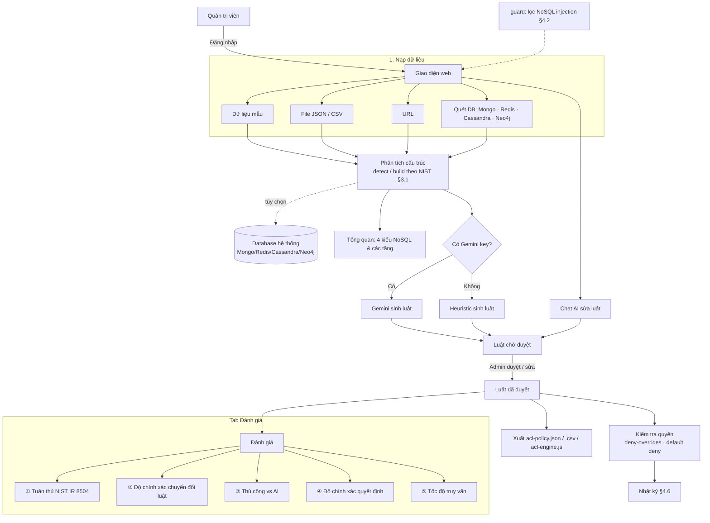
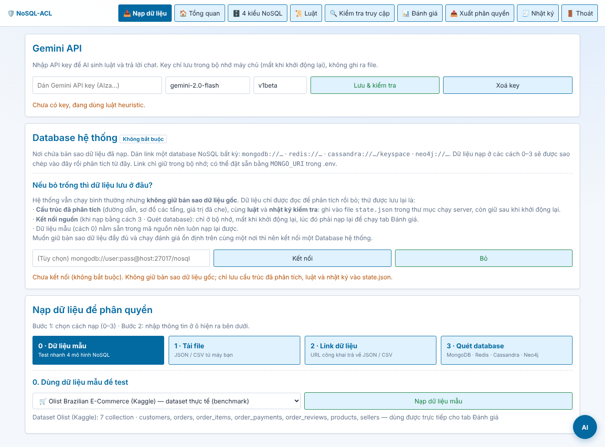
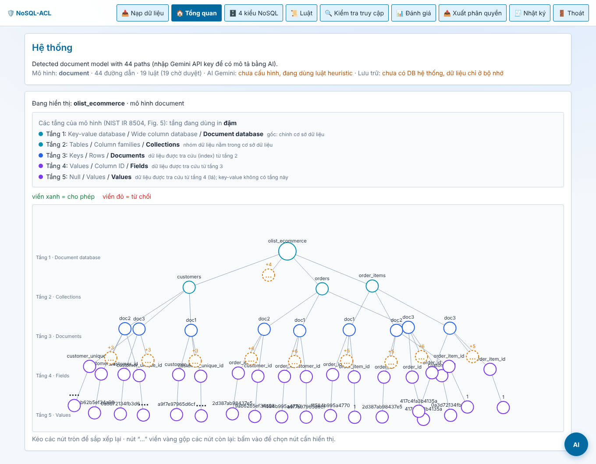
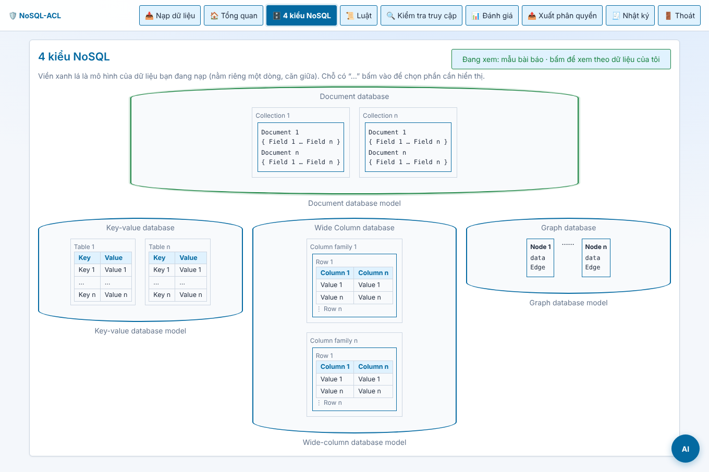
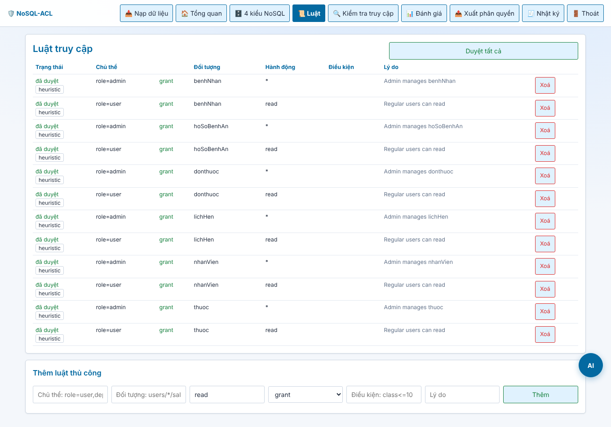
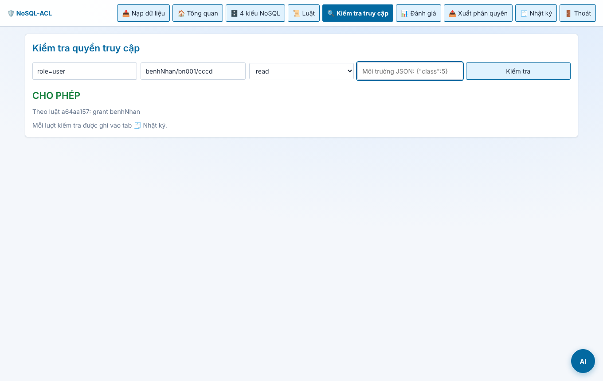
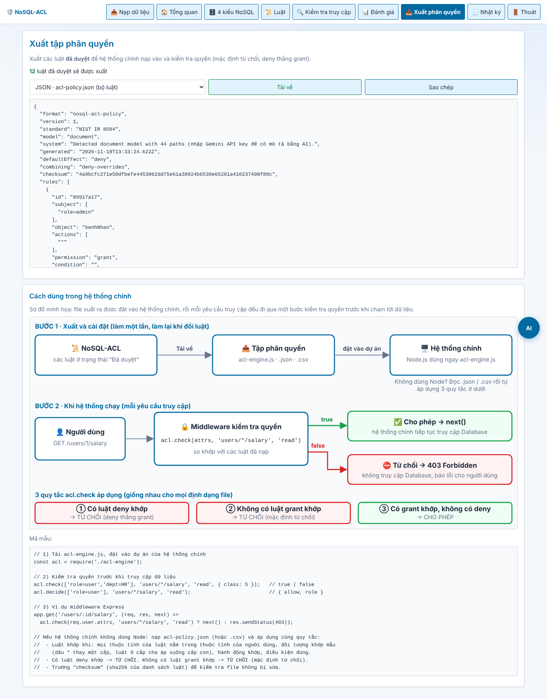
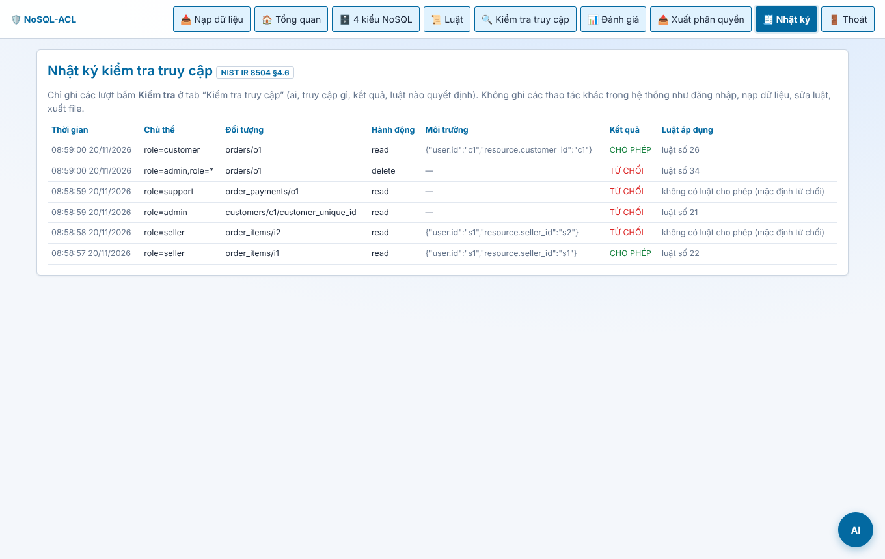
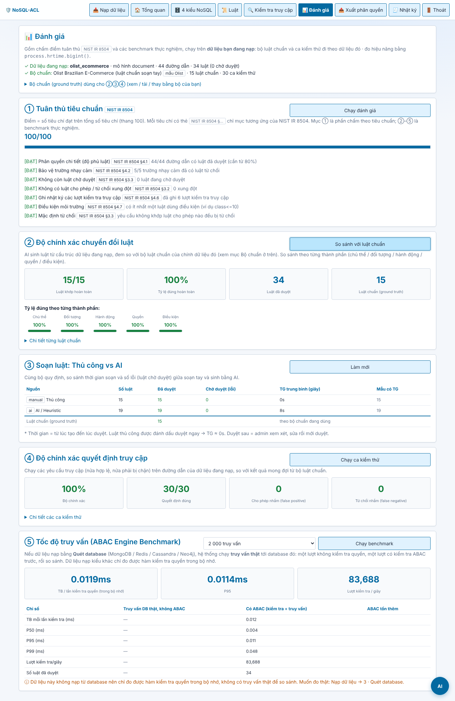

# NoSQL-ACL — Quản lý phân quyền cho cơ sở dữ liệu NoSQL (theo NIST IR 8504)

Công cụ web giúp quản trị viên **tự động sinh, duyệt, kiểm tra và xuất bộ luật kiểm soát truy cập** cho 4 kiểu cơ sở dữ liệu NoSQL (key-value, wide-column, document, graph), dựa trên tài liệu **NIST IR 8504 – *Access Control on NoSQL Databases*** (Vincent C. Hu, 05/2024). AI (Gemini) hỗ trợ đề xuất luật; nếu không có API key, hệ thống dùng luật heuristic.

## Mục lục
1. [Giới thiệu hệ thống](#1-giới-thiệu-hệ-thống)
2. [Vấn đề](#2-vấn-đề)
3. [Mục tiêu](#3-mục-tiêu)
4. [Sơ đồ chức năng](#4-sơ-đồ-chức-năng)
   - [Kịch bản minh họa](#kịch-bản-minh-họa-một-luồng-dữ-liệu-olist)
5. [Dataset](#5-dataset)
6. [Đánh giá](#6-đánh-giá)
7. [Chụp màn hình](#7-chụp-màn-hình)
8. [Kết luận và hướng phát triển](#8-kết-luận-và-hướng-phát-triển)
9. [Cài đặt và chạy](#9-cài-đặt-và-chạy)
10. [Cấu trúc thư mục & API](#10-cấu-trúc-thư-mục--api)

---

## 1. Giới thiệu hệ thống

NoSQL-ACL là ứng dụng **Node.js + Express** (giao diện web một trang) hoạt động như một *bộ quản lý chính sách truy cập* đứng cạnh hệ thống chính:

- **Nạp dữ liệu** từ dữ liệu mẫu, file JSON/CSV, URL, hoặc quét trực tiếp database thật (MongoDB, Redis, Cassandra, Neo4j).
- **Phân tích cấu trúc** theo mô hình các tầng của NIST IR 8504 (Sec. 3.1): *database → bảng/collection → key/row/document → trường → giá trị*. Dữ liệu nhạy cảm được che (`••••`) khi hiển thị.
- **Sinh luật** truy cập bằng Gemini (hoặc heuristic), quản trị viên **duyệt** từng luật trước khi có hiệu lực.
- **Kiểm tra quyền** (`subject, object, action, ctx`) bằng bộ máy quyết định *deny-overrides, mặc định từ chối*, hỗ trợ điều kiện môi trường (ví dụ `class<=10`).
- **Xuất phân quyền** ra `acl-policy.json`, `acl-policy.csv` hoặc `acl-engine.js` (middleware `acl.check()` dùng ngay trong hệ thống Node).
- **Đánh giá** hệ thống: tuân thủ NIST, độ chính xác chuyển đổi luật, soạn luật thủ công vs AI, độ chính xác quyết định, chi phí hiệu năng.
- **Database hệ thống** (không bắt buộc): lưu dữ liệu đã nạp vào một DB NoSQL riêng (`mongodb://`, `redis://`, `cassandra://`, `neo4j://`/`bolt://`).

**Bảo mật tích hợp:** bộ lọc NoSQL injection (`guard`) cho mọi `/api`, token HMAC-SHA256 hết hạn 8 giờ, giới hạn 5 lần đăng nhập sai/10 phút, chống SSRF khi nạp URL, header bảo mật (CSP, X-Frame-Options…), nhật ký mọi lượt kiểm tra truy cập (§4.6), giới hạn body JSON 20 MB.

## 2. Vấn đề

- Các CSDL NoSQL **không có lược đồ cố định** và mỗi kiểu (key-value, wide-column, document, graph) có cấu trúc dữ liệu, cách truy cập và cơ chế phân quyền riêng, trong khi nhiều hệ thống chỉ có phân quyền thô (theo vai trò hoặc theo database).
- Viết luật phân quyền **thủ công** cho từng collection/field tốn thời gian, dễ sót trường nhạy cảm (email, lương, thẻ, chẩn đoán…) và dễ sinh luật xung đột.
- Không có công cụ chung để **đánh giá** một bộ luật có đủ độ phủ, có tuân thủ khuyến nghị của NIST IR 8504 và quyết định có đúng hay không.
- NoSQL đối mặt với **injection** (`$ne`, `$where`, `$regex`…) mà lớp phân quyền thường bỏ qua.

## 3. Mục tiêu

1. Nhận diện và biểu diễn thống nhất cấu trúc của **4 kiểu NoSQL** theo NIST IR 8504 §3.1.
2. **Tự động đề xuất luật** (AI/heuristic), có bước **duyệt của con người** trước khi áp dụng.
3. Cài đặt bộ máy quyết định theo §3.2–3.3: phân quyền chi tiết đến trường (kế thừa từ cha xuống con), *deny-overrides*, *default deny*, điều kiện môi trường (§4.7).
4. Ghi **nhật ký** kiểm tra truy cập (§4.6) và lọc **injection** (§4.2).
5. **Xuất** bộ luật để áp dụng vào hệ thống thật.
6. Cung cấp **bộ đánh giá định lượng** để chứng minh chất lượng luật và chi phí của lớp phân quyền.

## 4. Sơ đồ chức năng



| Tab | Chức năng |
|---|---|
| **Nạp dữ liệu** | Gemini API key, Database hệ thống (không bắt buộc), 4 cách nạp dữ liệu |
| **Tổng quan** | Mô tả hệ thống, sơ đồ cấu trúc dữ liệu đang nạp |
| **4 kiểu NoSQL** | Hình minh họa Key-value / Wide-column / Document / Graph và bảng 5 tầng |
| **Luật** | Xem, thêm, **sửa thủ công (nút Sửa)**, xoá, duyệt luật; mỗi luật có **số thứ tự** (cột `#`). Chat với AI để sửa tại chỗ, ví dụ “sửa luật 3 thành deny” (luật sửa giữ nguyên số thứ tự, chờ duyệt lại) |
| **Kiểm tra truy cập** | Thử `subject – object – action – ctx`, trả về cho phép/từ chối và luật quyết định |
| **Xuất phân quyền** | Tải JSON / CSV / `acl-engine.js` |
| **Nhật ký** | Các lượt kiểm tra truy cập: lưu tối đa 500 lượt gần nhất, giao diện hiển thị 100 lượt mới nhất |
| **Đánh giá** | 5 mục đánh giá + bộ chuẩn (ground truth) |

> Số thứ tự luật là vị trí trong danh sách (từ 1) và được dùng thay cho mã ngẫu nhiên ở tab Kiểm tra truy cập, Nhật ký và Đánh giá. Khi xoá một luật, các luật phía sau dồn lên một số.

**Quy tắc quyết định:** (1) có luật `deny` khớp → từ chối; (2) có luật `grant` khớp → cho phép; (3) không khớp luật nào → từ chối. Luật ở đối tượng cha áp dụng cho con (`orders/*` bao phủ `orders/*/card`).

### Kịch bản minh họa (một luồng, dữ liệu Olist)

Bối cảnh: sàn thương mại điện tử Olist cần phân quyền cho 7 collection trước khi cho 6 nhóm người dùng (`admin`, `seller`, `customer`, `support`, `finance`, `analyst`) truy cập. Các giai đoạn dưới đây đi theo đúng thứ tự trong sơ đồ.

| Giai đoạn (theo sơ đồ) | Quản trị viên làm gì | Trường hợp / kết quả |
|---|---|---|
| **1. Đăng nhập** | Vào giao diện web, đăng nhập `ADMIN_USER` / `ADMIN_PASS` | Đúng → nhận token 8 giờ. Sai 5 lần trong 10 phút → bị khoá tạm thời. |
| **2. Nạp dữ liệu** | Tab *Nạp dữ liệu* → chọn mẫu **Olist** (có thể nhập Gemini API key) | Nạp thành công 7 collection. Không có key → hệ thống dùng luật heuristic thay cho Gemini. Nạp file/URL/DB thật cũng đi qua bước này. |
| **3. Phân tích cấu trúc** | Tab *Tổng quan* | Hiện cây *database → collection → document → trường*. Trường nhạy cảm (`customer_unique_id`, `payment_value`, `review_comment_message`…) được che `••••`. |
| **4. Sinh luật** | Tab *Luật* | Gemini (hoặc heuristic) đề xuất luật; mọi luật ở trạng thái **chờ duyệt**, chưa có hiệu lực. |
| **5. Duyệt / sửa luật** | Xem bảng luật theo số thứ tự `#`, rồi duyệt | **Đúng** → bấm *Duyệt*. **Sai một phần** → bấm *Sửa*, hoặc nhắn chat "sửa luật 3 thành deny" (luật giữ số, chờ duyệt lại). **Thừa** → *Xoá* hoặc nhắn chat "xoá luật 4". **Thiếu** → *Thêm* thủ công hoặc nhờ chat. Có thể nhập nhanh bộ luật chuẩn từ Excel mẫu (15 luật, đã duyệt). |
| **6. Kiểm tra quyền** | Tab *Kiểm tra truy cập*, nhập `subject – object – action – ctx` | Xem 5 ca ở bảng dưới. Mỗi lượt cho biết CHO PHÉP / TỪ CHỐI và *luật số N* quyết định. |
| **7. Nhật ký** | Tab *Nhật ký* | Mỗi lượt kiểm tra ở bước 6 được ghi lại (thời gian, chủ thể, đối tượng, kết quả, luật số). Lưu tối đa 500 lượt. |
| **8. Xuất phân quyền** | Tab *Xuất phân quyền* | Chỉ luật **đã duyệt** được xuất ra `acl-policy.json`, `acl-policy.csv` hoặc `acl-engine.js`. Luật còn chờ duyệt bị bỏ qua. |
| **9. Đánh giá** | Tab *Đánh giá*, bộ chuẩn `olist` (15 luật + 30 ca) | ① điểm tuân thủ NIST IR 8504 (7 tiêu chí) · ② luật AI so với luật chuẩn · ③ thủ công vs AI · ④ độ chính xác 30 ca quyết định · ⑤ tốc độ truy vấn. Chỗ nào sai hoặc thiếu thì quay lại bước 5 để sửa rồi chạy lại. |

**Các ca kiểm tra ở giai đoạn 6** (theo bộ luật chuẩn Olist; luật do AI sinh có thể cho kết quả khác, và đó chính là điều giai đoạn 9 đo):

| # | Yêu cầu | Kết quả | Lý do |
|---|---|---|---|
| a | `role=seller` đọc `order_items/i1`, ctx `user.id=s1`, `resource.seller_id=s1` | CHO PHÉP | Khớp luật cho phép và điều kiện sở hữu đúng. |
| b | Như (a) nhưng `resource.seller_id=s2` | TỪ CHỐI | Điều kiện không thỏa → không có luật cho phép khớp (mặc định từ chối). |
| c | `role=admin` đọc `customers/c1/customer_unique_id` | TỪ CHỐI | Luật `deny` thắng luật toàn quyền của admin (*deny-overrides*). |
| d | `role=support` đọc `order_payments/o1` | TỪ CHỐI | Không có luật cho phép nào nhắc tới support trên thanh toán. |
| e | Chủ thể `role=admin,role=*` xoá `orders/o1` | TỪ CHỐI | Luật cấm xoá đơn hàng áp dụng cho mọi vai trò. |

Ngoài luồng chính, mọi yêu cầu `/api` đều đi qua bộ lọc injection: gửi nội dung có `$where`, `$ne`… (ví dụ ở ô Đối tượng) sẽ bị chặn với lỗi 400 `Blocked: NoSQL injection pattern`.

## 5. Dataset

### 5.1 Dữ liệu mẫu cho 4 kiểu NoSQL (`data/samples.js`)

| Mẫu | Mô hình | Nội dung |
|---|---|---|
| `keyvalue` | Key-value | `session`, `cache` (khóa như `sess:1`, `user:1:token`) |
| `wide` | Wide-column | `profile` (name, dept, salary), `logs` (ip, ts) |
| `document` | Document | `users` (name, email, role, salary), `orders` (id, total, card) |
| `graph` | Graph | 6 nút (user, group, company, file, department, organization) và 5 cạnh (`in`, `works for`, `managed by`, `belongs to`, `can read`) |

### 5.2 Dataset Olist Brazilian E-Commerce (`data/olist.js`)

Dataset chính để đánh giá, nguồn [Brazilian E-Commerce Public Dataset by Olist (Kaggle)](https://www.kaggle.com/datasets/olistbr/brazilian-ecommerce), mô hình **document**, gồm 7 collection (tên bảng và tên cột giữ nguyên như bộ dữ liệu gốc, kể cả lỗi chính tả `lenght`):

| Collection | Nội dung | Trường nhạy cảm tiêu biểu |
|---|---|---|
| `customers` | Khách hàng | `customer_unique_id`, `customer_zip_code_prefix` |
| `orders` | Đơn hàng và mốc thời gian giao nhận | — |
| `order_items` | Dòng hàng của đơn (sản phẩm, người bán, giá, phí vận chuyển) | — |
| `order_payments` | Thanh toán | `payment_value` |
| `order_reviews` | Đánh giá của khách | `review_comment_message` |
| `products` | Danh mục sản phẩm | — |
| `sellers` | Người bán | — |

> **Lưu ý:** dữ liệu trong `data/olist.js` chỉ là vài dòng mẫu liên kết với nhau theo đúng lược đồ Olist, không phải toàn bộ bộ dữ liệu trên Kaggle (khoảng 100.000 đơn hàng). Để dùng dữ liệu đầy đủ, tải các file CSV từ Kaggle (ví dụ `olist_customers_dataset.csv`) rồi nạp ở *Nạp dữ liệu → Tải file*.

Kèm theo là **bộ chuẩn (ground truth)**: **15 luật** soạn tay (`OLIST_GT`, 7 vai trò: `admin`, `seller`, `customer`, `support`, `finance`, `analyst`, `role=*`) và **30 ca kiểm thử** (`OLIST_TESTS`), cũng có trong `ground-truth.json`.

### 5.3 Dữ liệu của người dùng

- File `.json` / `.csv`, URL công khai (chặn địa chỉ nội bộ), hoặc quét DB thật (tối đa 12 bảng, vài bản ghi mỗi bảng).
- Bộ chuẩn riêng nạp ở tab *Đánh giá → Bộ chuẩn*:
  ```json
  {"rules":[{"subject":["role=user"],"object":"orders/*/card","actions":["read"],"permission":"deny"}],
   "tests":[{"subject":["role=user"],"object":"orders/o1/card","action":"read","expected":false}]}
  ```
  `tests` có thể bỏ trống, hệ thống tự sinh từ luật.

## 6. Đánh giá

Tab **📊 Đánh giá** chạy trên *dữ liệu đang nạp*. Bộ chuẩn có 3 chế độ: `olist` (15 luật + 30 ca soạn tay), `auto` (luật tham chiếu tự sinh: admin/editor/user, chặn trường nhạy cảm, chặn xoá — chỉ mang tính tham khảo), `custom` (người dùng tự nạp).

| Mục | Đo gì | Cách tính |
|---|---|---|
| **① Tuân thủ NIST IR 8504** | Điểm theo 7 tiêu chí | Phân quyền chi tiết (độ phủ ≥ 80% đường dẫn) · bảo vệ trường nhạy cảm · không còn luật chờ duyệt · không xung đột grant/deny · ghi nhật ký · điều kiện môi trường · mặc định từ chối |
| **② Độ chính xác chuyển đổi luật** | Luật AI/heuristic so với luật chuẩn | Khớp chính xác và theo từng thành phần: subject, object, action, permission, condition |
| **③ Thủ công vs AI** | Số luật, tỷ lệ duyệt, thời gian duyệt trung bình | Từ `createdAt` → `approvedAt` theo nguồn luật |
| **④ Độ chính xác quyết định** | Chạy các ca kiểm thử | Accuracy, *false allow* (cho phép nhầm — nghiêm trọng), *false deny* |
| **⑤ Tốc độ truy vấn** | Chi phí của lớp ABAC | Cùng một danh sách yêu cầu chạy hai nhánh: chỉ truy vấn DB (baseline) và kiểm tra quyền + truy vấn DB, đổi thứ tự luân phiên; báo cáo avg, p50/p95/p99, QPS, % overhead. Không có DB thật thì chỉ đo hàm quyết định trong bộ nhớ |

**Kết quả thử nghiệm** (dataset Olist; 34 luật đã duyệt gồm 19 luật **heuristic** tự sinh vì chưa dùng Gemini key và 15 luật **thủ công nhập từ `data/luat-mau-olist.xlsx`**; chế độ đo trong bộ nhớ):

| Tiêu chí | Kết quả |
|---|---|
| Điểm tuân thủ NIST IR 8504 (①) | **100/100** (7/7 tiêu chí đạt) |
| Khớp chính xác luật chuẩn (②) | 15/15 luật (100%); cả 5 thành phần subject, object, action, permission, condition đều 100% |
| Soạn luật thủ công vs AI (③) | thủ công 15 luật, duyệt ngay (0 s); heuristic 19 luật, duyệt trung bình khoảng 7 s |
| Độ chính xác quyết định (④) | 30/30 ca (100%): false allow 0, false deny 0 |
| Chi phí kiểm tra quyền (⑤) | trung bình khoảng 0,007 ms/lần, p95 khoảng 0,011 ms, khoảng 143.000 lượt/giây (thay đổi nhẹ giữa các lần chạy) |

Nhận xét: nếu chỉ dùng luật heuristic (chỉ phân quyền theo `role=admin` và `role=user`) thì kết quả thấp hơn nhiều (86/100, 1/15 luật khớp, 17/30 ca đúng) do lệch nghiệp vụ Olist (seller, customer, support, finance, analyst…). Sau khi nhập bộ luật thủ công, các luật heuristic không gây xung đột vì chỉ áp dụng cho `role=user` và `role=admin`, còn *deny-overrides* giữ nguyên các luật chặn. Chi phí của hàm kiểm tra quyền rất nhỏ (dưới 0,03 ms). Chưa đo so với truy vấn DB thật (cần nạp bằng cách 3 hoặc kết nối Database hệ thống).

---

## 7. Chụp màn hình

> Ảnh chụp với dataset Olist Brazilian E-Commerce, sau khi nhập 15 luật mẫu từ Excel, lưu trong `docs/screenshots/`.

| Nạp dữ liệu | Tổng quan |
|---|---|
|  |  |

| 4 kiểu NoSQL | Luật truy cập |
|---|---|
|  |  |

| Kiểm tra quyền | Xuất phân quyền |
|---|---|
|  |  |

| Nhật ký | Đánh giá |
|---|---|
|  |  |

## 8. Kết luận và hướng phát triển

### Kết luận

- Hệ thống đã hiện thực được quy trình trọn vẹn: **nạp dữ liệu → phân tích cấu trúc → sinh luật (AI/heuristic) → duyệt → kiểm tra quyền → xuất → đánh giá**, hỗ trợ cả 4 kiểu NoSQL.
- Bộ máy quyết định (*deny-overrides*, *default deny*, kế thừa cha–con, điều kiện môi trường) đơn giản, dễ giải thích và xuất được thành `acl-engine.js` dùng ngay.
- Bước **duyệt luật bởi người** giúp tránh để AI tự quyết định quyền; bộ lọc injection và nhật ký đáp ứng thêm §4.2 và §4.6.
- Bộ đánh giá định lượng (tuân thủ, độ chính xác luật, độ chính xác quyết định, overhead) cho phép so sánh các bộ luật khác nhau một cách khách quan.

### Hạn chế

- Quét DB ngoài chỉ lấy **mẫu nhỏ** (vài bản ghi, tối đa 12 bảng), nên luật sinh ra dựa trên cấu trúc nhìn thấy.
- Bộ chuẩn tự sinh (`auto`) chỉ mang tính tham khảo; chuẩn xác phải dựa trên bộ chuẩn soạn tay.
- Trạng thái lưu trong `state.json` (một quản trị viên, chưa có nhiều người dùng/vai trò quản trị).
- Link database và Gemini API key chỉ giữ trong bộ nhớ, khởi động lại phải nhập lại.
- Điều kiện môi trường mới hỗ trợ biểu thức so sánh đơn (`key<=10`).
- Chưa kiểm thử tự động (unit test) cho bộ máy quyết định và bộ lọc.

### Hướng phát triển

1. Quản trị **nhiều người dùng, phân vai** (người soạn / người duyệt), lưu lịch sử thay đổi luật.
2. **Tích hợp trực tiếp** (middleware/driver) để thực thi luật ở tầng truy vấn Mongo/Redis/Cassandra/Neo4j thay vì chỉ xuất file.
3. Hỗ trợ điều kiện phức tạp hơn (thời gian, địa chỉ IP, thuộc tính đối tượng; kết hợp AND/OR) và phát hiện luật chồng chéo/thừa.
4. Quét sâu hơn (lấy mẫu theo thống kê, nhận diện trường nhạy cảm bằng AI) và phát hiện **thay đổi lược đồ** để đề xuất luật mới.
5. Cải thiện chất lượng AI: thử nhiều mô hình, đo ② theo từng mô hình, thêm few-shot từ bộ chuẩn.
6. Bổ sung unit test, CI, đóng gói Docker; mở rộng bộ dataset (tài chính, giáo dục…) và bộ chuẩn.
7. Mở rộng nhật ký: cảnh báo bất thường, xuất log sang SIEM.

---

## 9. Cài đặt và chạy

Yêu cầu: **Node.js ≥ 20.6** (`npm start` chạy `node --env-file=.env server.js`, nên cần file `.env`).

```bash
cp .env.example .env     # điền GEMINI_API_KEY (tùy chọn), ĐỔI ADMIN_PASS và APP_SECRET
npm install
npm start                # http://localhost:3000
```

| Biến `.env` | Ý nghĩa |
|---|---|
| `ADMIN_USER`, `ADMIN_PASS` | Tài khoản quản trị (mặc định `admin`; **phải đổi mật khẩu**) |
| `APP_SECRET` | Chuỗi ký token (đặt chuỗi ngẫu nhiên dài) |
| `GEMINI_API_KEY`, `GEMINI_MODEL`, `GEMINI_API_VERSION` | Tùy chọn (mặc định model `gemini-2.0-flash`, API `v1beta`); cũng có thể nhập key trên giao diện (chỉ lưu trong bộ nhớ). Không có key vẫn chạy với luật heuristic |
| `MONGO_URI` | Tùy chọn: database hệ thống đặt sẵn (mẫu: `mongodb://localhost:27017/nosql`); cũng có thể nhập link `redis://`, `cassandra://`, `neo4j://` trên giao diện |
| `PORT` | Cổng (mặc định 3000) |

**Database hệ thống (không bắt buộc):** nhập link ở *Nạp dữ liệu → Database hệ thống* (`mongodb://…`, `redis://…`, `cassandra://…/keyspace` — keyspace phải có sẵn, `neo4j://…`/`bolt://…`). Khi kết nối, mọi nguồn nạp được sao chép vào DB này, hệ thống đọc lại từ đó để phân tích và benchmark. Bỏ trống thì không giữ bản sao dữ liệu gốc, chỉ lưu cấu trúc, luật, nhật ký vào `state.json`.

## 10. Cấu trúc thư mục & API

```
nosql-acl/
├── server.js          # API, bộ máy quyết định, guard, đánh giá
├── data/
│   ├── samples.js     # 4 mẫu keyvalue / wide / document / graph
│   ├── olist.js       # dataset Olist E-Commerce + 15 luật chuẩn + 30 ca kiểm thử
│   └── store.js       # database hệ thống (Mongo/Redis/Cassandra/Neo4j)
├── public/index.html  # giao diện
├── ground-truth.json  # bộ chuẩn mẫu: 15 luật + 30 ca (tải về chỉnh rồi nạp lại)
├── docs/screenshots/  # 8 ảnh chụp màn hình dùng ở mục 7
├── state.json         # tự tạo khi chạy: cấu trúc, luật, nhật ký (không đưa lên git)
├── .env.example
├── package.json       # express, mongodb, redis, cassandra-driver, neo4j-driver
└── README.md
```

| API (cần đăng nhập, trừ `login`) | Mô tả |
|---|---|
| `POST /api/login` | Đăng nhập, trả token |
| `POST /api/ingest` | Nạp dữ liệu (`upload`, `url`, `sample`, `mongo`, `redis`, `cassandra`, `neo4j`) |
| `GET /api/state`, `GET /api/graph` | Trạng thái, đồ thị cấu trúc |
| `GET/POST/PATCH/DELETE /api/rules`, `POST /api/rules/approve-all` | Quản lý luật |
| `POST /api/chat` | Chat AI chỉnh luật |
| `POST /api/check`, `GET /api/audit` | Kiểm tra quyền; nhật ký (100 lượt mới nhất) |
| `GET /api/export?format=json\|csv\|js` | Xuất phân quyền |
| `GET /api/evaluate` | Điểm tuân thủ NIST IR 8504 (7 tiêu chí) |
| `GET /api/eval/bench-info`, `…/rule-accuracy`, `…/authoring`, `…/decision-accuracy` | Đánh giá ②③④ |
| `POST /api/eval/performance` | Đánh giá ⑤ |
| `GET/POST/DELETE /api/eval/ground-truth` | Bộ chuẩn |
| `POST/DELETE /api/gemini-key`, `POST/DELETE /api/system-db` | Cấu hình key và database hệ thống |

*Cập nhật README (20/11/2026): đổi dataset sang Olist, bỏ tiêu chí injection khỏi mục ①, chụp lại 8 ảnh và cập nhật số liệu đánh giá (100/100, 15/15 luật khớp, 30/30 ca đúng sau khi nhập luật mẫu từ Excel).*

*Tham chiếu:* Vincent C. Hu, **NIST IR 8504 – Access Control on NoSQL Databases**, 05/2024.

## Nhập luật thủ công từ Excel

Tab **Luật → Nhập luật thủ công từ Excel** nhận file `.xlsx` (sheet đầu tiên) hoặc `.csv` với các cột `id, subject, object, actions, permission, condition, reason`.
Bản mẫu `data/luat-mau-olist.xlsx` (cũng tải được từ nút "Tải file Excel mẫu") khớp 15/15 luật và 30/30 test của `ground-truth.json` khi nạp bộ dữ liệu Olist.
Điều kiện hỗ trợ `== != <= >= < >`, `&&`, `||`; vế phải có thể là thuộc tính khác (ví dụ `user.khoa == resource.khoa`).
